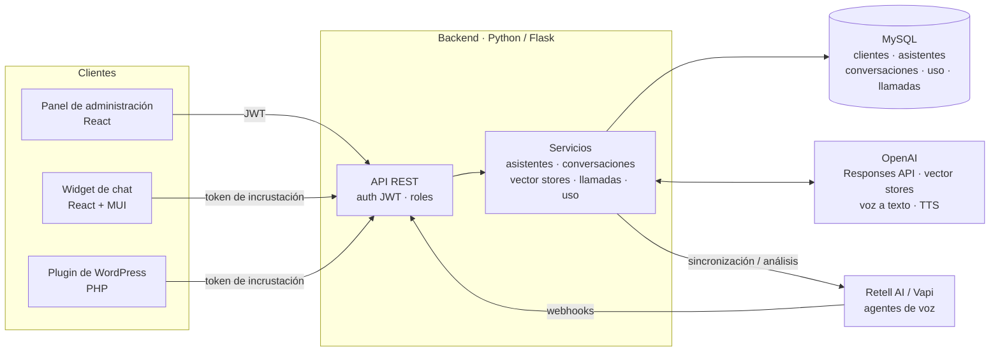

# Caso de estudio: plataforma multicliente de asistentes con IA

🇬🇧 [Read in English](README.md)

> **Sobre este documento.** Construí esta plataforma en mi trabajo. El código es propiedad de la empresa, así que esto es un **caso de estudio** y no contiene código fuente. He omitido los nombres de la empresa, de los clientes y del producto.
> Para enseñar las mismas ideas con código, rehíce el núcleo desde cero como proyecto open source: **[assistant-studio](https://github.com/marc-tutusaus/assistant-studio)**.

## Contexto

Una empresa de servicios IT quería vender **asistentes de IA** a sus clientes: chatbots en sus webs y agentes de IA que atendieran sus **líneas de teléfono**. Cada cliente necesitaba sus propios asistentes, su conocimiento y sus informes de uso. El equipo interno necesitaba **un único sitio** para crearlos, ajustarlos y supervisarlos sin tocar código.

## Qué construí

| Área | Funcionalidades |
|---|---|
| **Panel de administración** | Empresas → proyectos → asistentes, usuarios y roles, credenciales por proyecto |
| **Gestión de asistentes** | Crear, editar, clonar y borrar asistentes: modelo, instrucciones, herramientas, parámetros. Asociarles bases de conocimiento. |
| **Conocimiento (RAG)** | Subir documentos a vector stores y asociarlos a los asistentes (file search) |
| **Chat** | Conversaciones con historial, **respuestas en streaming (SSE)**, voz a texto y texto a voz |
| **Canales incrustables** | Un **widget de chat que se incrusta con una línea** (en cualquier web) y un **plugin de WordPress**, autenticados con un **token de incrustación** por proyecto (sin claves de API en el navegador) y con estilo propio por asistente |
| **Agentes de voz** | Integración con **Retell AI** y **Vapi**: números de teléfono, recepción de llamadas por webhooks, historial de llamadas, sincronización y recuperación de llamadas incompletas |
| **Análisis de llamadas con IA** | Un LLM analiza la transcripción de cada llamada y genera un resultado estructurado (resumen, resultado, intención) y **etiquetas automáticas**, además de notas manuales y una agenda de contactos |
| **Analítica de uso** | Cada llamada al modelo queda registrada con tokens (entrada/salida), latencia y estado. Paneles diarios y por conversación, por proyecto y por asistente. |

## Arquitectura



## Decisiones técnicas clave

### 1. Migrar de la Assistants API a la Responses API en plena producción

OpenAI anunció que retiraba la Assistants API, de la que dependía la plataforma: los asistentes, los hilos y las ejecuciones eran objetos remotos en OpenAI. Hice la migración **de forma gradual y sin cortes de servicio**:

- **Un flag `api_mode` por proyecto.** Los proyectos se migraban de uno en uno y los dos modos convivían durante la migración.
- **Configuración del asistente guardada en local** (modelo, instrucciones, herramientas, parámetros). Antes solo existía como objetos remotos en OpenAI.
- **Conversaciones en local.** Los hilos ya no existen, así que los mensajes se guardan en nuestra base de datos y los turnos se encadenan con `previous_response_id`.
- **Resolución de IDs.** Se aceptan tanto los IDs remotos antiguos como los nuevos IDs locales, así que los widgets ya instalados en las webs de los clientes siguieron funcionando.
- **Scripts de migración e importación**, uno por cliente, que copian los asistentes remotos al modelo local.

*Resultado:* la parte específica del proveedor quedó reducida a un adaptador fino. La configuración de los asistentes, el historial y el uso pasaron a ser **datos nuestros**, listos para analítica y para cambiar de proveedor.

### 2. Streaming con Server-Sent Events

El widget muestra el texto a medida que se genera. El backend convierte el stream del proveedor en SSE, que funciona dentro de una página de WordPress sin necesidad de WebSockets.

### 3. Multicliente y credenciales

Las empresas tienen proyectos, y los proyectos tienen asistentes, conocimiento y tokens de incrustación. Los roles controlan qué ve cada usuario. Las claves de API de los proveedores de voz se guardan **por empresa**, así que cada cliente usa su propia cuenta y su propia facturación.

### 4. Incrustar sin exponer secretos

Los widgets públicos se autentican con un **token de incrustación** ligado a un proyecto. El token determina qué asistentes se pueden usar y con qué aspecto. Las claves de los proveedores nunca llegan al navegador.

### 5. Un widget de chat que funciona en cualquier web

El frontend del chat es una **app independiente en React + MUI** que cualquier web incrusta con **una sola etiqueta script**:

```html
<script src="https://<widget-host>/widget.js"
        data-iframe-src="https://<widget-host>/?token=<embed-token>"
        data-button-bg="#0b5fff" data-width="400" data-height="640"
        data-mobile-fullscreen="true" async></script>
```

- **Script cargador.** Añade un botón flotante y un **iframe** con la app. El CSS y el JavaScript de la web anfitriona no pueden romper el widget, ni el widget puede romper la web. Tamaño, colores, posición, márgenes, z-index y pantalla completa en móvil se configuran con atributos `data-*`, así que no hace falta compilar nada para cada cliente.
- **El mismo widget en todas partes**: webs en HTML, CMSs y un **plugin de WordPress** que solo envuelve este snippet con una página de ajustes.
- **Pensado para visitantes reales**: historial de conversaciones, botones de acciones rápidas, indicador de "escribiendo", entrada por voz y respuestas habladas, un **formulario de captación** de datos de contacto y un **aviso de privacidad y consentimiento** antes de chatear.
- El aspecto y el comportamiento vienen de la **configuración de incrustación** guardada por proyecto en el backend (decisión 4). Un cliente puede cambiar de color o de asistente sin volver a publicar su web.

### 6. Las llamadas de voz como datos

Las llamadas llegan por webhook, se guardan, se pueden volver a sincronizar si llegaron incompletas y después **las analiza un LLM**, que genera campos estructurados y etiquetas. Una llamada se convierte en un registro que se puede buscar, en vez de una grabación que nadie escucha. La misma idea la apliqué después en el workflow de captación de leads de [n8n-ai-automations](https://github.com/marc-tutusaus/n8n-ai-automations).

### 7. Registro de uso desde el primer día

Cada llamada al modelo escribe una fila de uso (proyecto, asistente, conversación, tokens, latencia, estado). Los paneles de uso y el control de costes por cliente salen directamente de consultas SQL sobre esa tabla.

## Stack

Python · Flask · SQLAlchemy · MySQL · JWT · React (panel de administración) · React + MUI + Vite (widget) · PHP (plugin de WordPress) · OpenAI Responses API, vector stores, voz a texto y TTS · Retell AI · Vapi · SSE

## Resultados

La plataforma tiene asistentes en producción para organizaciones de sectores muy distintos. Omito los nombres de los clientes.

**Asistentes de chat**

| Tipo de cliente | Uso |
|---|---|
| La propia empresa de servicios IT | Asistente en la web para clientes y potenciales clientes |
| Un ayuntamiento (administración pública) | Información a la ciudadanía en su web |
| Una empresa privada | Asistente privado sobre el conocimiento interno de la empresa |
| Una plataforma online para estudiantes | Asistente para los usuarios de la plataforma |

**Agentes de voz con IA (líneas de teléfono)**

| Tipo de cliente | Uso |
|---|---|
| La propia empresa de servicios IT | Centralita: llamadas de soporte y comerciales, tickets fuera de horario |
| Una empresa privada de asistencia médica | Atención de llamadas entrantes |
| Una entidad de servicios sociales que gestiona la economía de personas con problemas de adicciones | Atención de llamadas entrantes para un público sensible y vulnerable |

**Impacto**

- **De perder hasta un 40% de las llamadas a atender el 100%.** Antes de los agentes de voz, según el cliente, se perdía hasta un 40% de las llamadas entrantes (equipo ocupado o fuera del horario de oficina). Ahora la IA atiende el 100%, a cualquier hora.
- Cada llamada deja un **registro estructurado**: resumen, análisis, etiquetas y, cuando corresponde, un ticket o un lead para el equipo. Se acabaron las llamadas a las que nadie da seguimiento.
- **Una plataforma para muchos clientes y canales.** Un asistente nuevo para un cliente nuevo es configuración (instrucciones, conocimiento, token de incrustación, estilo), no un proyecto de desarrollo nuevo.
- La **migración a la Responses API** sacó todos los proyectos de la Assistants API, que OpenAI estaba retirando, sin dejar de dar servicio a los clientes. Los widgets ya instalados en sus webs siguieron funcionando.

## Qué haría diferente

- **Independencia del proveedor desde el principio.** La migración demostró lo caro que es depender del modelo de objetos de un solo proveedor. En [assistant-studio](https://github.com/marc-tutusaus/assistant-studio) la configuración del asistente es nuestra y hay adaptadores para Claude, OpenAI, Gemini y modelos locales.
- **Tests automáticos** en las partes de conversaciones y uso antes de refactorizaciones grandes como la migración.
- **Conjuntos de evaluación** para los asistentes (respuestas esperadas por cliente), para medir los cambios de prompt o de modelo en lugar de valorarlos a ojo.
- **Terminar de migrar el análisis de llamadas** a la Responses API con salidas estructuradas (esquema JSON), en lugar de extraer el JSON de un texto libre.

---

© 2026 Marc Tutusaus Vilanova. Todos los derechos reservados. Ver [LICENSE](LICENSE).
