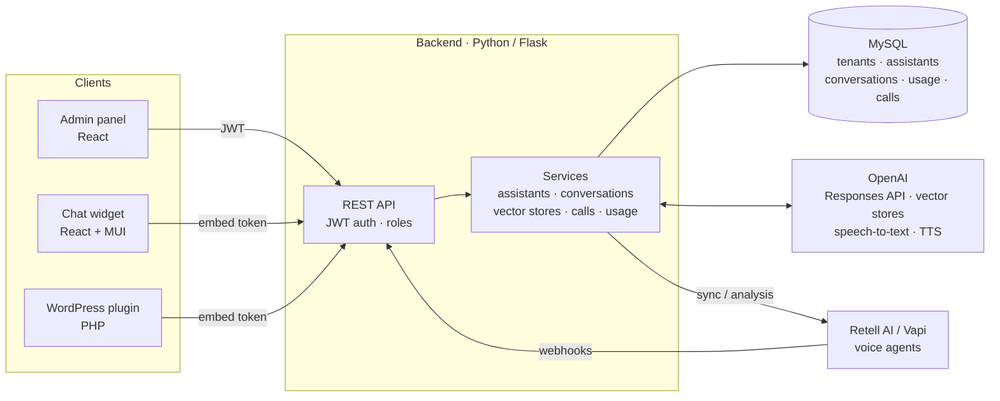

# Case Study: Multi-tenant AI Assistant Platform

🇪🇸 [Leer en español](README.es.md)

> **About this document.** I built this platform at work. Its code is proprietary, so this is a **case study** and contains no source code. Company, client and product names are omitted.
> To show the same ideas in code, I rebuilt the core from scratch as an open-source project: **[assistant-studio](https://github.com/marc-tutusaus/assistant-studio)**.

## Context

An IT services company wanted to sell **AI assistants** to its clients: chatbots on their websites and AI agents answering their **phone lines**. Each client needed its own assistants, knowledge and usage reporting. The internal team needed **one place** to create, tune and monitor all of them without touching code.

## What I built

| Area | Capabilities |
|---|---|
| **Admin panel** | Companies → projects → assistants, users and roles, per-project credentials |
| **Assistant management** | Create, edit, clone and delete assistants: model, instructions, tools, sampling. Attach knowledge bases. |
| **Knowledge (RAG)** | Upload documents to vector stores and attach them to assistants (file search) |
| **Chat** | Conversations with history, **streaming responses (SSE)**, speech-to-text and text-to-speech |
| **Embeddable channels** | A **one-line embeddable chat widget** (any website) and a **WordPress plugin**, authenticated with a per-project **embed token** (no API keys in the browser), with per-assistant styling |
| **Voice agents** | Integration with **Retell AI** and **Vapi**: phone numbers, call ingestion through webhooks, call history, sync and refresh of incomplete calls |
| **AI call analysis** | Each call transcript is analyzed by an LLM to produce a structured result (summary, outcome, intent) and **auto-tags**, plus manual notes and a contact book |
| **Usage analytics** | Every model call logged with tokens (in/out), latency and status. Daily and per-conversation dashboards per project and assistant. |

## Architecture



## Key technical decisions

### 1. Migrating from the Assistants API to the Responses API, while in production

OpenAI announced the deprecation of the Assistants API, which the platform depended on: assistants, threads and runs were all remote objects. I migrated it **gradually, without downtime**:

- **Per-project `api_mode` flag**, so projects moved one at a time and both modes ran side by side during the migration.
- **Assistant config stored locally** (model, instructions, tools, sampling). Before, it lived only as remote OpenAI objects.
- **Local conversations.** Threads no longer exist, so messages are stored in our database and turns are chained with `previous_response_id`.
- **Id resolution** accepts both legacy remote ids and new local ids, so widgets already embedded on client sites kept working.
- **Migration and import scripts**, one per tenant, that copy remote assistants into the local model.

*Result:* the provider-specific layer became a thin adapter. Assistant config, history and usage are now **our data**, ready for analytics and for switching providers.

### 2. Streaming over Server-Sent Events

The widget shows tokens as they arrive. The backend turns the provider's stream into SSE, which works in a WordPress page without WebSockets.

### 3. Multi-tenancy and credentials

Companies own projects, and projects own assistants, knowledge and embed tokens. Roles control what each user sees. Voice-provider API keys are stored **per company**, so each client uses its own account and its own billing.

### 4. Embeds without exposing secrets

Public widgets authenticate with an **embed token** tied to a project. The token resolves which assistants may be used and how they look. Provider keys never reach the browser.

### 5. A chat widget that drops into any website

The chat front end is a standalone **React + MUI app** that any site embeds with **one script tag**:

```html
<script src="https://<widget-host>/widget.js"
        data-iframe-src="https://<widget-host>/?token=<embed-token>"
        data-button-bg="#0b5fff" data-width="400" data-height="640"
        data-mobile-fullscreen="true" async></script>
```

- **Loader script.** It injects a floating launcher button and an **iframe** with the app. The host page's CSS and JavaScript cannot break the widget, and the widget cannot break the host. Size, colors, position, gaps, z-index and mobile full-screen are all `data-*` attributes, so no build is needed per client.
- **The same widget everywhere**: plain HTML sites, CMSs and a **WordPress plugin** that only wraps this snippet with a settings page.
- **Built for real visitors**: conversation history, quick-action buttons, typing indicator, voice input and spoken replies, a **lead form** to capture contact details, and a **privacy/consent dialog** before chatting.
- Look and behavior come from the **embed config** stored per project in the backend (decision 4). A client gets a new color or assistant without redeploying their site.

### 6. Voice calls as data

Calls arrive by webhook, are stored, can be re-synced when incomplete, and are then **analyzed by an LLM** into structured fields and tags. A call becomes a searchable record instead of a recording nobody listens to. The same idea later fed the n8n lead-capture workflow in [n8n-ai-automations](https://github.com/marc-tutusaus/n8n-ai-automations).

### 7. Usage logging from day one

Every model call writes a usage row (project, assistant, conversation, tokens, latency, status). The usage dashboards and per-client cost tracking come straight from SQL on this table.

## Stack

Python · Flask · SQLAlchemy · MySQL · JWT · React (admin panel) · React + MUI + Vite (widget) · PHP (WordPress plugin) · OpenAI Responses API, vector stores, speech-to-text and TTS · Retell AI · Vapi · SSE

## Results

The platform runs assistants in production for organizations in very different sectors. Client names are omitted.

**Chat assistants**

| Client type | Use |
|---|---|
| The IT services company itself | Website assistant for customers and prospects |
| A city council (public administration) | Citizen information on its website |
| A private company | Private assistant over the company's own knowledge |
| An online platform for students | Assistant for the platform's users |

**AI voice agents (phone lines)**

| Client type | Use |
|---|---|
| The IT services company itself | Switchboard: support and sales calls, after-hours tickets |
| A private medical assistance company | Inbound call handling |
| A social-services organization that manages finances for people with addiction problems | Inbound call handling for a sensitive, vulnerable audience |

**Impact**

- **From up to 40% of calls missed to 100% answered.** Before the voice agents, depending on the client, up to 40% of inbound calls went unanswered (team busy or outside office hours). Now the AI answers 100% of them, around the clock.
- Every call leaves a **structured record**: summary, analysis, tags and, where relevant, a ticket or a lead for the team. No more calls that nobody follows up.
- **One platform for many clients and channels.** A new assistant for a new client is configuration (instructions, knowledge, embed token, styling) instead of a new development project.
- The **migration to the Responses API** moved every project off the deprecated Assistants API while it kept serving clients, and widgets already embedded on client websites kept working.

## What I would do differently

- **Provider-agnostic from the start.** The migration showed the cost of depending on one vendor's object model. In [assistant-studio](https://github.com/marc-tutusaus/assistant-studio) the assistant config is ours, and adapters cover Claude, OpenAI, Gemini and local models.
- **Automated tests** around the conversation and usage paths before big refactors such as the migration.
- **Evaluation sets** for assistants (expected answers per client), so prompt and model changes are measured, not judged by eye.
- **Finish moving call analysis** to the Responses API with structured outputs (JSON schema) instead of parsing JSON from free text.

---

© 2026 Marc Tutusaus Vilanova. All rights reserved. See [LICENSE](LICENSE).
